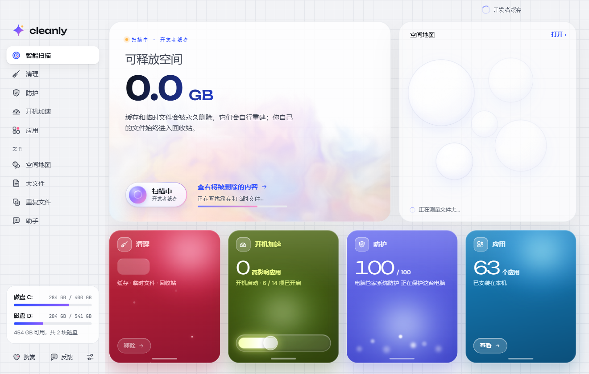
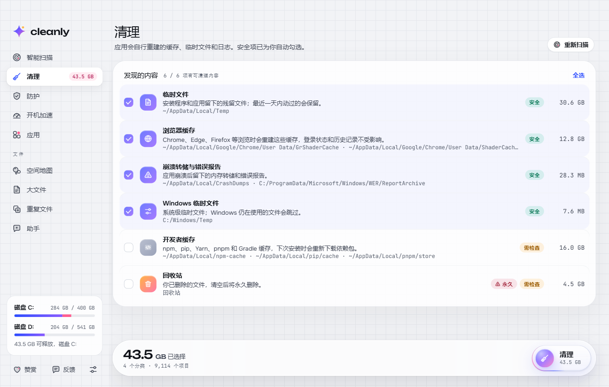

# Cleanly 中文版（非官方汉化）

[Cleanly](https://beyond-media.ai) 是一款界面精致、体积小、无广告的 Windows 磁盘清理工具（作者 0xCodez）。它本身**不支持中文**：没有 i18n 框架、没有语言切换，所有界面文案硬编码为英文。

本仓库提供基于 **Cleanly 0.1.1（Electron 45.1.0，Windows x64）** 的非官方汉化版安装包：界面、提示、错误信息、时间显示全部中文化，**未修改任何程序逻辑**。

## 下载

- 最新安装包：见 [Releases](../../releases/latest)
- 文件名：`Cleanly-0.1.1-zh-CN-Setup.exe`
- 大小：108 MB
- SHA256：`C2158C2C218CCEF520CBEEDA8FB55C25319C940C8EBD65F0572C9699F48AD79B`
- 系统要求：**Windows 10 / 11 64 位**

## 安装

1. 从 Releases 下载安装包；
2. 双击安装，向导界面为中文，默认安装到 `%LOCALAPPDATA%\Programs\Cleanly`（当前用户，**无需管理员权限**，可自选路径）；
3. 首次运行如出现 SmartScreen「Windows 已保护你的电脑」，点「更多信息 → 仍要运行」；
4. 安装完成后桌面快捷方式打开即为中文界面。

## 汉化范围

- 导航：智能扫描 / 清理 / 防护 / 开机加速 / 应用 / 空间地图 / 大文件 / 重复文件 / 助手 / 赞赏 / 反馈 / 设置
- 扫描首页、清理分类与说明、安全/需检查标签、确认弹层
- 应用列表、搜索排序、卸载确认
- 空间地图、大文件、重复文件的统计、筛选、排序与提示
- 防护评分与状态明细、启动项管理、管理员提示
- 助手（Claude / ChatGPT 密钥）、赞赏、反馈、设置的全部表单与提示
- 相对时间改为中文习惯（刚刚 / 3 分钟前 / 2 天前）

以下内容保留英文，避免误导：应用名与发行商、真实文件与文件夹路径、启动命令、品牌名（Microsoft Defender / Claude / ChatGPT / Stripe 等）。

## 说明

- 汉化通过替换打包内界面文案实现，程序逻辑、扫描与清理行为与原版完全一致；
- 应用自动更新会下载并覆盖汉化文件，届时重新安装本安装包即可；
- 卸载会删除程序文件，但保留 `%APPDATA%\Cleanly` 中的个人设置（扫描偏好、助手密钥等）；
- AI 助手、赞赏、反馈需要联网，助手需自行填写 API Key；纯清理、扫描等功能可离线使用。

## 免责声明

- 本项目为**非官方个人汉化**，仅供学习交流与个人使用，与 Cleanly 原作者无关；
- Cleanly 及其相关权利归原作者 **0xCodez / beyond-media.ai** 所有，请支持正版；
- **禁止商用、禁止二次售卖**；
- 若原作者认为本仓库侵犯其权益，请联系删除，仓库将立即下架。

## 截图

